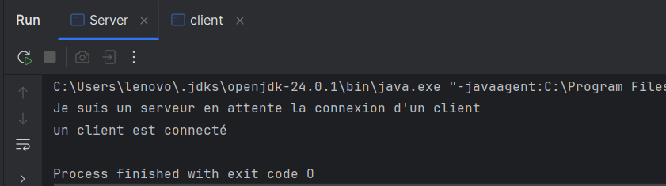
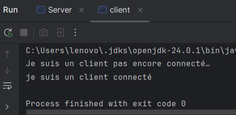
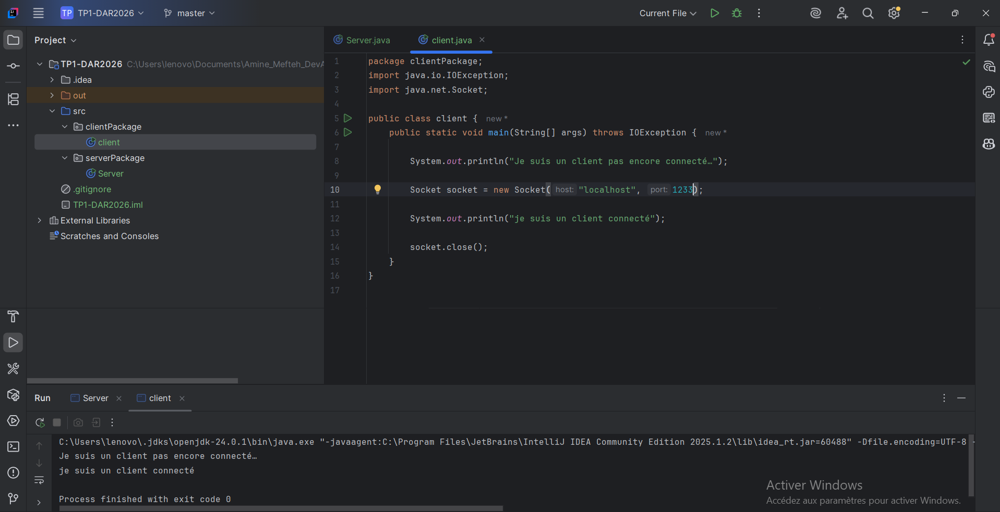
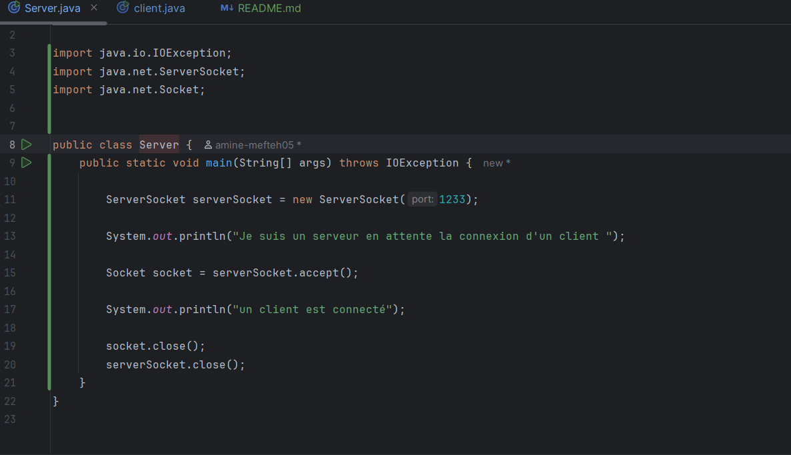

# TP Sockets Java

## Activité 1_1 : Première communication Client/Serveur

### Étape 3 : Application Serveur

**Interprétation :** Le serveur crée un `ServerSocket` sur le port 1233 et affiche
« Je suis un serveur en attente de la connexion d'un client ». Il reste bloqué sur
`accept()` tant qu'aucun client ne s'est connecté.

### Étape 4 : Application Client

**Interprétation :** Le client affiche « Je suis un client pas encore connecté... »,
puis crée un `Socket` vers `localhost:1233`. Une fois la connexion établie, il affiche
« Je suis un client connecté », et la console du serveur affiche « Un client est
connecté ».

**Interprétation :** Les deux consoles confirment que la connexion est établie : le
serveur est sorti de `accept()`, puis les sockets sont fermés des deux côtés.

### Étape 4.f : Remplacement de localhost par une adresse IP

**Interprétation :** Le fonctionnement est identique avec l'adresse IP `127.0.0.1` :
`localhost` n'est que le nom symbolique de cette adresse de bouclage (la machine
elle-même).