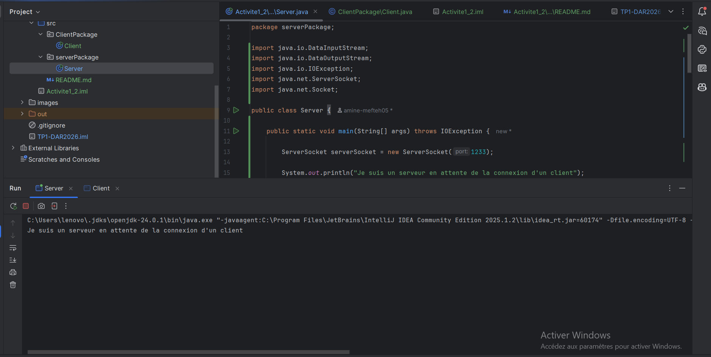
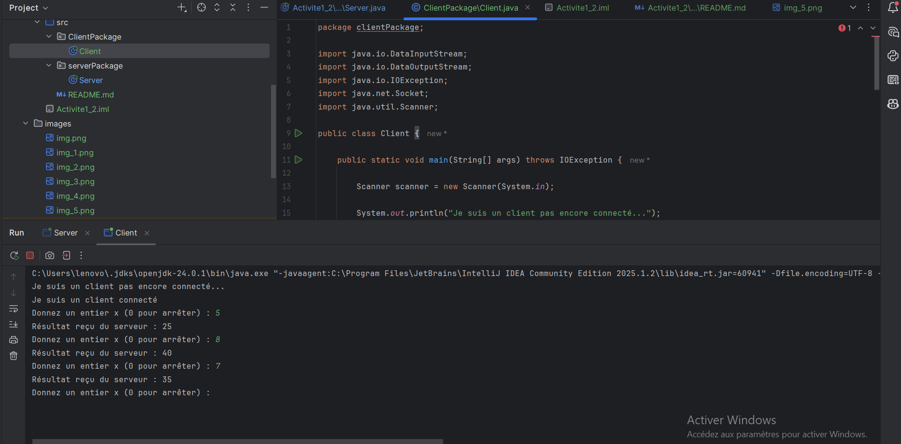
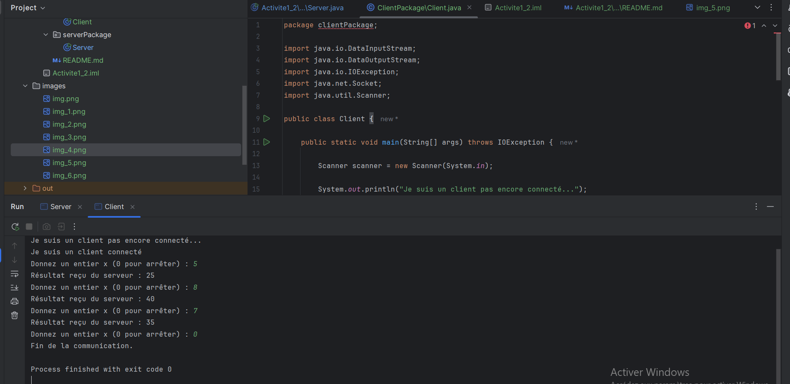

## Activité 1_2 : Service de multiplication

### Étape 2 : Échange d'entiers (x * 5)

**Interprétation :** Le client saisit un entier x et l'envoie avec `writeInt()`.
Le serveur, bloqué sur `readInt()`, le reçoit, calcule x * 5 et renvoie le
résultat avec `writeInt()`. Le client l'affiche. Les valeurs positives (4 → 20),
négatives (-3 → -15) sont traitées correctement grâce à `DataInputStream` et
`DataOutputStream`, qui transmettent l'entier sur 4 octets.

### Arrêt de la communication

**Interprétation :** Le processus continue tant que x est différent de 0. Quand
l'utilisateur saisit 0, le client l'envoie, le serveur sort de sa boucle, puis les
flux et les sockets sont fermés des deux côtés.